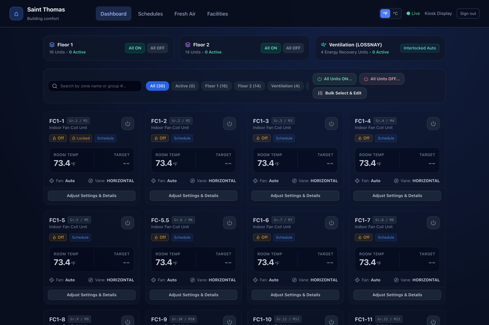
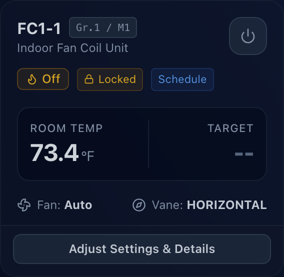
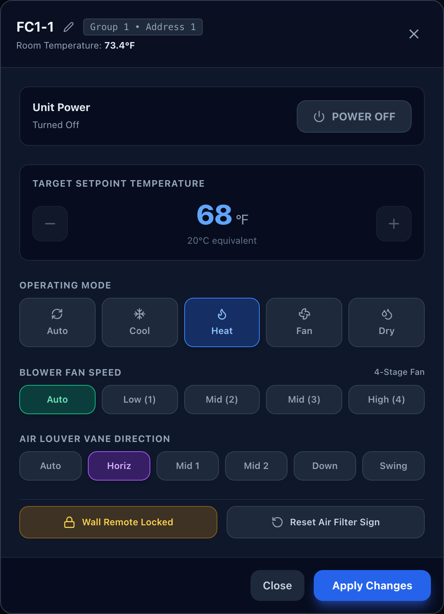
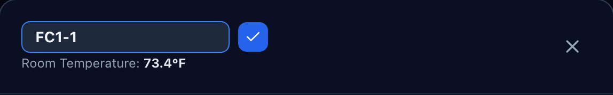
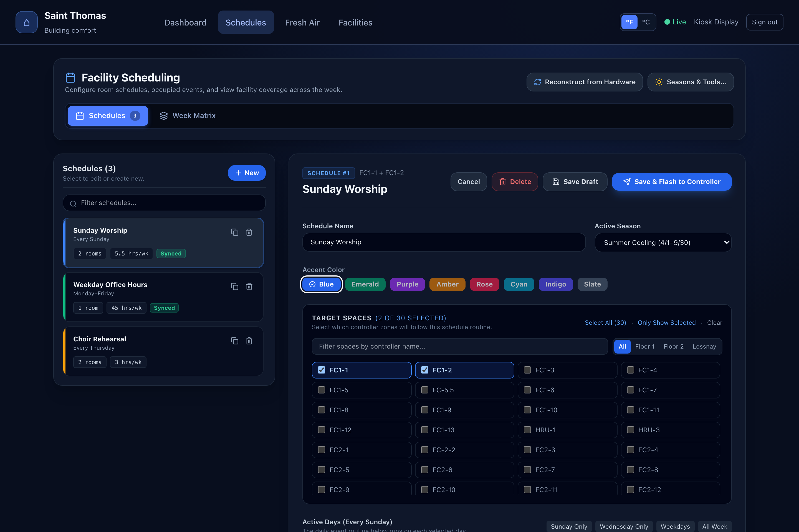
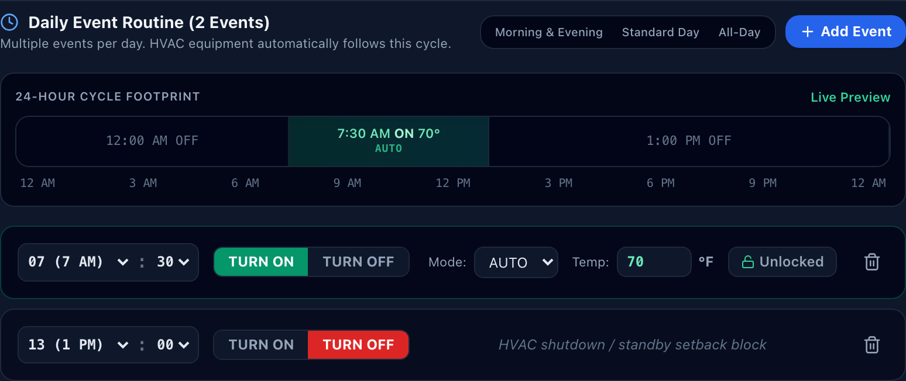
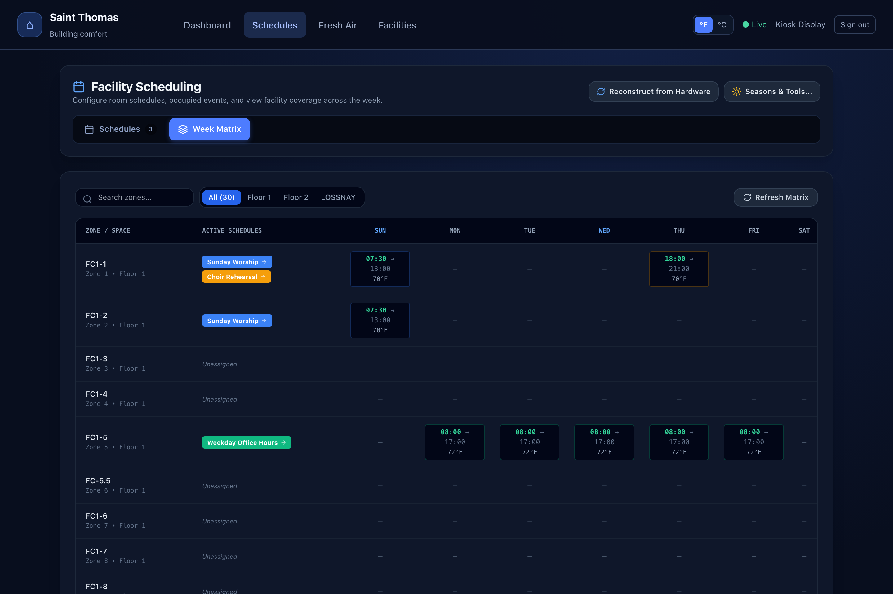
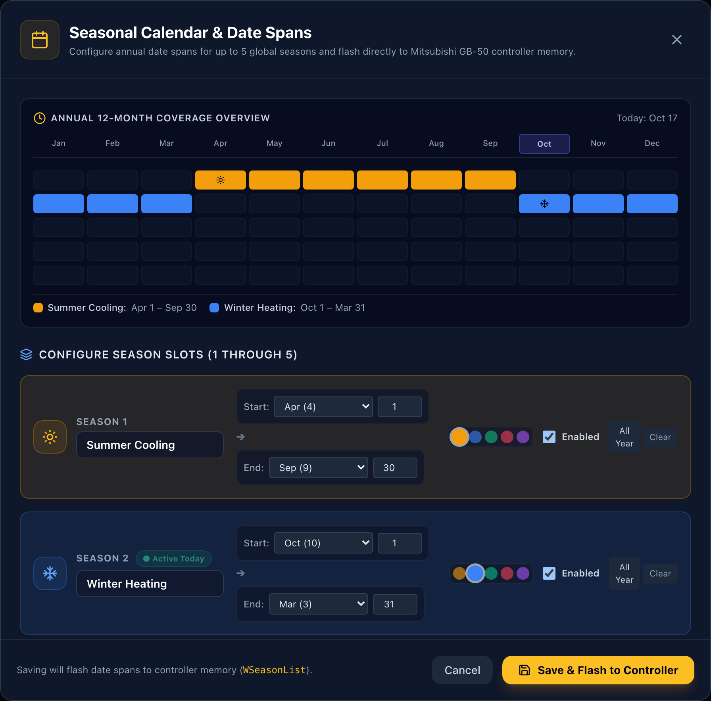
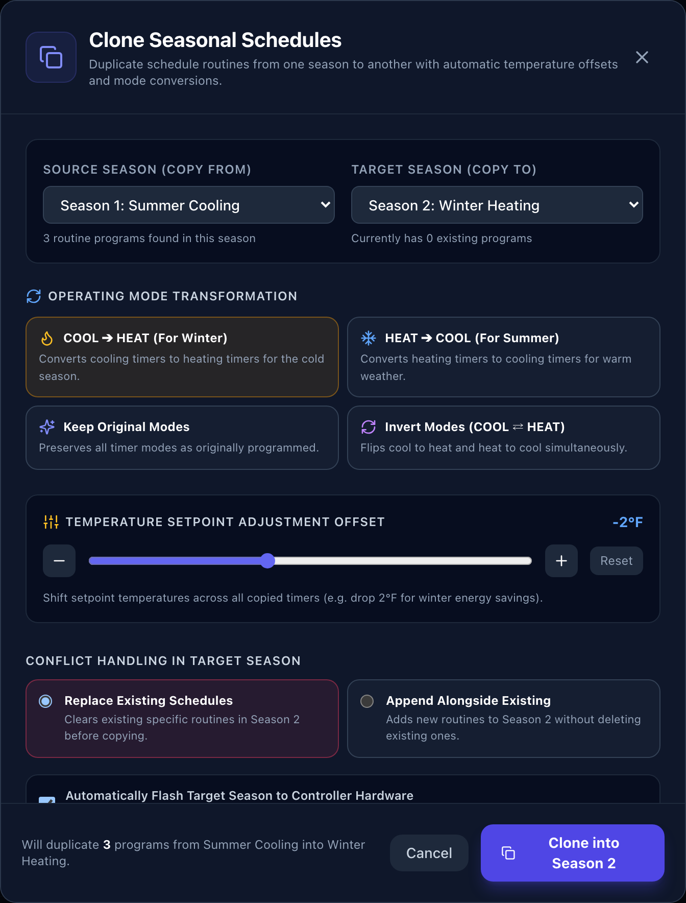

# HVAC Controller User Guide
## Quick Reference: Thermostats, Schedules & Seasons

Access the portal in your browser at `http://<your-controller-address>`.

---

## 1. Direct Thermostat Management

### Dashboard Overview
The main dashboard displays rooms organized by floor, with live temperatures and equipment states:



---

### Reading a Room Card
Each room card displays real-time telemetry:



- **Status Badge**: Green (`RUNNING`) when active, gray when turned off.
- **Temperature**: Large number is current room temperature; smaller badge is target setpoint.
- **Fan & Vane**: Current blower speed (`Low`, `Mid`, `High`, `Auto`) and air angle.
- **Remote Locked (`🔒`)**: Indicates wall thermostat buttons are locked against tampering.
- **Clean Filter (`⚠️`)**: Appears when the indoor unit filter needs routine cleaning.

---

### Adjusting Temperature & Settings
1. Click **Adjust Settings & Details** on any room card to open the control window:



2. **Power**: Click **POWER ON** or **POWER OFF**.
3. **Temperature**: Use **`+`** (warmer) or **`−`** (cooler) in 0.5° increments.
4. **Mode**: Choose **AUTO** (maintains target year-round), **COOL**, **HEAT**, **FAN**, or **DRY**.
5. **Fan / Louver**: Choose blower stage or air swing direction.
6. **Wall Remote Lock**: Toggle between **Permitted** (wall buttons active) and **Locked** (wall buttons disabled).
7. Click **Apply Changes**.

---

### Renaming a Room
1. In the room control window, click the **Pencil icon** (`✎`) beside the name:



2. Type the new room name and click the **Checkmark** (`✓`). Changes take effect immediately.

---

### Clearing "Clean Filter" Alerts
1. Clean or replace the indoor unit filter.
2. In the room control window, click **Reset Air Filter Sign**.
3. Click **Apply Changes**.

---

## 2. Managing Schedules

Schedules automatically heat or cool spaces before occupants arrive, and turn equipment off when unoccupied. Manual adjustments on the dashboard do not erase schedules.

Navigate to **Schedules** in the top bar:



---

### Creating a New Schedule
1. Click **+ New** above the schedule list.
2. **Name & Color**: Enter a descriptive name (e.g. *Morning Occupied*, *Weekday Business Hours*) and select an accent color.
3. **Active Season**: Choose which season this schedule applies to (e.g. *Summer Cooling* or *Winter Heating*).
4. **Target Spaces**: Check the rooms that will follow this schedule. Use search or floor filters to locate spaces quickly.
5. **Active Days**: Select the days this routine runs (e.g. *Weekdays*, *Specific Days*, or *All Week*).
6. **Daily Event Routine**:
   - **Start Event**: Set time (30–45 min before arrival), choose **TURN ON**, select **Mode** and **Comfort Temp**.
   - **Stop Event**: Set closing time and choose **TURN OFF**.
   - *(Optional)* Click **+ Add Event** for intermediate temperature setbacks.



7. **Review 24-Hour Timeline Bar**: Verify active operating hours on the visual bar.
8. Click **Save & Flash to Controller** to write the routine permanently into hardware memory.

> [!NOTE]
> - **Save Draft**: Saves in software only (not sent to equipment).
> - **Save & Flash to Controller**: Writes schedule into physical controller EEPROM so it runs even if disconnected from the network.

---

### Editing, Copying & Deleting Schedules
- **Edit**: Select any schedule on the left, update values, and click **Save & Flash to Controller**.
- **Copy**: Click the **Duplicate icon** (`⧉`) next to a schedule name to clone its configuration.
- **Delete**: Select the schedule, click the red **Delete** button, and confirm. The rooms are immediately unassigned.

---

### Week Matrix View
Click **Week Matrix** to view all rooms and active schedule blocks across all 7 days:



---

## 3. Seasons & Schedules

### How Seasons Work
Seasons eliminate reprogramming schedules twice a year:
- **Summer Schedules**: Set to cool rooms to comfortable summer temperatures (e.g. 72°F).
- **Winter Schedules**: Set to heat rooms to comfortable winter temperatures (e.g. 68°F).
- **Midnight Controller Evaluation**: Every midnight, the controller checks its internal clock against season date ranges and executes only the schedules belonging to today's active season.

```
[ Today's Date ] ──► [ Controller Checks Active Season ] ──► [ Runs Matching Seasonal Schedules ]
```

---

### Setting Season Dates
1. In **Schedules**, click **Seasons & Tools...** ➔ **Configure Dates...**:



2. Review the **12-Month Coverage Overview**.
3. Set **Start Date** and **End Date** for each season (e.g., Summer: April 1 – September 30; Winter: October 1 – March 31).
4. Click **Save Seasonal Dates to Controller**.

---

### Cloning Schedules to a New Season
To transition from Summer to Winter in one click:
1. Click **Seasons & Tools...** ➔ **Clone Season...**:



2. Set **Source Season** (e.g. *Summer Cooling*) and **Target Season** (e.g. *Winter Heating*).
3. Select **Mode Transformation**: Choose **Cooling ➔ Heating** (or vice versa).
4. Set **Temperature Offset**: (e.g. `-2.0°F` to lower cooling setpoints to heating levels).
5. Click **Clone Seasonal Schedules**. Routines are copied, transformed, and flashed to hardware.

---

### Date Mismatch Warning
If an amber banner reads `⚠️ Seasonal Date Mismatch Detected`:
1. Click **Reconcile Season Dates**.
2. Click **Use Controller Hardware Dates (Recommended)** to synchronize the system.
